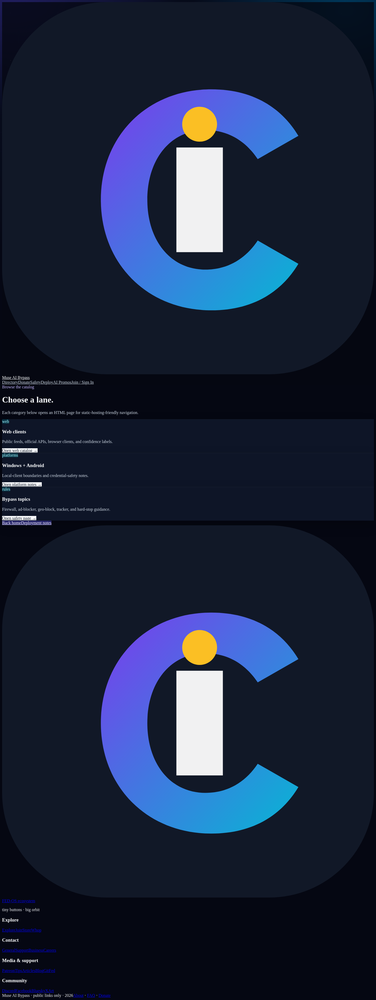
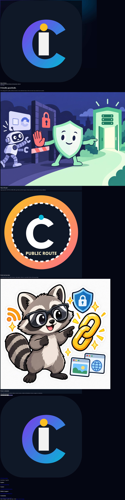

# Muse AI Bypass

A local-first catalog of official APIs, public feeds, public datasets, and safer alternatives when the normal route is unavailable.

> **Important:** This is a research and documentation project—not a bypass service. It does not defeat authentication, paywalls, CAPTCHA, DRM, MFA, geo-restrictions, rate limits, robots rules, or access controls.


[](LICENSE.md) [](clients/web/index.html) [](clients/web/deployment.html)

## Why this exists

When a service is blocked, login-gated, paywalled, anti-bot protected, or simply difficult to integrate, it is easy to waste time on stale mirrors, fragile third-party viewers, or unsafe credential workarounds.

This project makes the decision easier. It organizes documented alternatives by category, distinguishes official and licensed routes from fragile or unverified ones, and calls out hard stops instead of pretending every gate has a clever workaround.

It is intentionally different from a proxy or scraper: the project favors provider APIs, RSS/Atom feeds, public datasets, library access, subscriptions, and user-authorized OAuth. Entries are research notes, not permission to automate or republish a service.

## See it work

There is no hosted demo URL configured in this repository. The fastest real demo is the local static site:

1. Open [`clients/web/index.html`](clients/web/index.html) directly, or run the local server below.
2. Choose **Directory** to browse categories.
3. Choose **Safety** to review hard stops.
4. Choose **Donate** to see the payment-provider page with its age self-attestation gate.

### Real screenshots

These screenshots were captured from the actual local HTML pages in `clients/web/`—not mockups:






### Visual personality

The repository also includes the original promotional artwork used by the site:


## Quick start

No package manager or build tool is required.

```bash
# install
# Nothing to install: this is a dependency-free static site.

# run
cd clients/web
python3 -m http.server 8000
# Open http://127.0.0.1:8000/index.html

# test (from the repository root, in a second terminal)
python3 scripts/check_static_site.py
```

The real entry point is [`clients/web/index.html`](clients/web/index.html). The smoke test checks required files and local HTML links without contacting third-party services.

## What is included

- `clients/web/` — animated static landing page, HTML routes, favicon, illustrations, GIF, sponsor card, donation page, and catalog pages.
- `clients/web/web-clients.md` — categorized web/API research summary.
- `clients/web/browser-clients-simple.md` — compact client list derived from the supplied refresh.
- `clients/windows/` and `clients/android/` — platform safety and client planning notes.
- `clients/shared/` — shared authorization, credential, and hard-stop principles.
- `bypass/` — category-specific notes for firewalls, ad blockers, geo-blocks, trackers, and other access gates.
- `docs/` — how it works, setup, and FAQ material.
- `SOURCE_SPECIFICATION.txt` — the supplied source material preserved as provided.
- `FOOTER_SPECIFICATION.txt` — the supplied public-footer specification preserved as provided.

The compact catalog contains 92 entries from the supplied refresh, while the fuller notes include additional grouped entries, status caveats, dead routes, and unverified findings. Counts are not a guarantee of current availability.

## Deployment status

The site is suitable for static hosting on GitHub Pages or Cloudflare Pages because it uses relative HTML, CSS, JavaScript, SVG, PNG, and GIF assets. This repository does **not** currently contain a GitHub Actions workflow, Cloudflare project configuration, custom domain, or live deployment URL.

For a manual deployment:

- **GitHub Pages:** publish the directory containing `clients/web/` as the site root, or move/copy its contents to the Pages root.
- **Cloudflare Pages:** use `clients/web` as the project root, leave the build command empty, and deploy the static files as-is.

See [`clients/web/deployment.html`](clients/web/deployment.html) for the visual deployment notes and provider documentation links.

## Safety boundary

Prefer official or licensed routes. Never provide this project with another person's password, session cookie, MFA code, API key, recovery code, or private token. Stop at login walls, paywalls, CAPTCHA, DRM, MFA, geo-blocks, anti-bot challenges, robots restrictions, and rate limits.

Entries marked `HIGH`, `UNVERIFIED`, `DEAD`, or `NOT RECOMMENDED` are retained for research history only. Verify current primary documentation, terms, quotas, availability, and licensing before relying on any entry.

## Contributing

Contributions should improve accuracy and provenance: add primary documentation links, record the date checked, explain authentication and licensing requirements, and clearly label uncertainty. Do not add credential-harvesting instructions, access-control evasion, or claims of live availability without evidence.

## License and attribution

See [`LICENSE.md`](LICENSE.md). Third-party names, trademarks, URLs, APIs, software, and datasets remain subject to their owners' terms and licenses.
